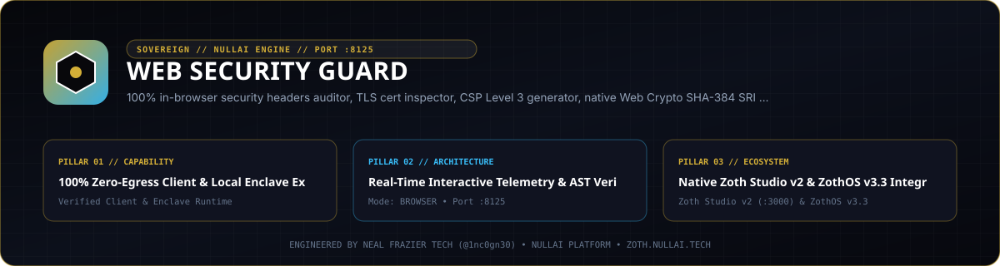

# Web Security Guard



Zero-dependency HTTP security header auditor, Content Security Policy (CSP) Level 3 generator, Subresource Integrity (SRI) SHA-256/384/512 pinning engine, TLS certificate inspector, Cross-Origin Isolation (`COOP`/`COEP`/`CORP`) analyzer, secret leakage scanner, and Model Context Protocol (MCP) server.

- **Local Workstation**: `http://127.0.0.1:8125`
- **Zoth Studio v2 Dossier**: [https://zoth.nullai.tech/tools/web-security-guard](https://zoth.nullai.tech/tools/web-security-guard)
- **Repository**: [https://github.com/1nc0gn30/web-security-guard](https://github.com/1nc0gn30/web-security-guard)

## Overview

Web Security Guard runs entirely on the Python 3.8+ standard library (`urllib`, `ssl`, `hashlib`, `html.parser`, `http.server`) and native browser Web Crypto APIs with zero runtime dependencies. It evaluates live URLs, raw HTML documents, and static deployment configurations against OWASP secure header baselines, RFC 6797 (HSTS), W3C CSP Level 3, W3C Subresource Integrity, and WCAG 2.2 contrast ratios.

Core capabilities:
- **HTTP Header & DOM Security Audit**: Scores targets from `0` to `100` (`A+` through `F`) across HSTS, CSP, `X-Content-Type-Options`, `X-Frame-Options`, `Referrer-Policy`, `Permissions-Policy`, insecure forms, and reverse tabnabbing.
- **CSP Level 3 Policy Synthesis**: Generates nonce- and hash-based policies tailored for Vanilla HTML, Next.js, React, Vue, Astro, Express, Django, and FastAPI in header, `<meta>`, Nginx, Apache, Netlify, Express, or JSON formats.
- **Subresource Integrity (SRI)**: Computes SHA-256, SHA-384, and SHA-512 base64 digests and rewrites `<script>` and `<link rel="stylesheet">` tags with `integrity` and `crossorigin="anonymous"` attributes.
- **TLS & Certificate Inspection**: Performs direct TLS handshakes to inspect protocol versions, cipher suites, Subject Alternative Names (SANs), issuer chains, and expiration windows.
- **Cross-Origin Isolation & Supply Chain**: Evaluates `Cross-Origin-Opener-Policy`, `Cross-Origin-Embedder-Policy`, `Cross-Origin-Resource-Policy`, Spectre timer exposure, third-party CDN trust, and mixed content.
- **Entropy & Pattern Secret Scanner**: Scans source files, inline scripts, and HTML payloads for exposed API keys, cloud credentials, private keys, and database URIs.

## Architecture

```text
web-security-guard/
├── server.py                         # Standalone loopback workstation entrypoint (127.0.0.1:8125)
├── bin/
│   ├── web-security.js               # Unified CLI, Web UI, and Electron desktop launcher
│   └── web-security-guard-tui        # Terminal dashboard launcher
├── public/                           # Zero-egress browser workstation (Web Crypto SRI, CSP builder)
├── src/web_security_guard/
│   ├── auditor.py                    # HTTP security header & HTML heuristic scoring engine
│   ├── csp.py                        # CSP Level 3 policy generator & framework presets
│   ├── sri.py                        # SHA-256/384/512 digest computation & HTML tag injector
│   ├── ssl_inspector.py              # Socket/TLS certificate & cipher suite inspector
│   ├── isolation_guard.py            # COOP/COEP/CORP & SharedArrayBuffer isolation analyzer
│   ├── secret_scanner.py             # Regex + Shannon entropy credential detector
│   ├── supply_chain_auditor.py       # Third-party script, missing SRI, and mixed-content scanner
│   ├── remediator.py & patcher.py    # Netlify, Vercel, Nginx, Apache, Caddy, Express config writers
│   ├── diff_analyzer.py              # Baseline-vs-hardened posture delta calculator
│   ├── wcag.py                       # WCAG 2.2 relative luminance contrast evaluator
│   ├── mcp_server.py                 # JSON-RPC 2.0 stdio MCP server (12 tools)
│   ├── ui_server.py                  # Threading HTTP REST API & static UI server
│   └── cli.py                        # sec-guard / web-security-guard CLI router
└── tests/                            # 300-test pytest suite
```

## Quickstart

```bash
git clone https://github.com/1nc0gn30/web-security-guard.git
cd web-security-guard
pip install -e .

# Launch the local web workstation and REST API on 127.0.0.1:8125
python3 server.py --port 8125
```

Open `http://127.0.0.1:8125` in any browser, or serve the static client bundle directly:

```bash
python3 -m http.server 8125 --directory public
```

## CLI & MCP Usage

Installing via `pip install -e .` registers `sec-guard` and `web-security-guard` (and ZothOS v3.4.0 exposes `web-security` / `web-security-guard` on `$PATH`).

```bash
# Check status and JSON telemetry
web-security-guard --help
web-security-guard --json

# Audit a live URL or local HTML file
sec-guard audit https://example.com --json
sec-guard check ./public/index.html --min-score 85

# Generate a strict CSP Level 3 policy
sec-guard csp --framework nextjs --preset strict --format netlify

# Compute SHA-384 SRI digest or inject SRI into HTML
sec-guard sri ./public/app.js --algorithm sha384 --json
sec-guard sri ./public/index.html --inject --no-fetch

# Inspect TLS certificate chain, SANs, and cipher suite
sec-guard ssl example.com --port 443 --json

# Audit Cross-Origin Isolation, secrets, supply chain, and WCAG contrast
sec-guard isolation https://example.com --json
sec-guard secrets ./public --json
sec-guard supply ./public/index.html --json
sec-guard contrast "#FFFFFF" "#0F172A" --level AAA --json

# Compare two targets or generate server hardening configs
sec-guard diff before.html after.html --json
sec-guard fix https://example.com --server-type nginx --output-dir ./hardening
sec-guard patch . --platform netlify --dry-run --json

# Launch the HTTP server on 127.0.0.1:8125
sec-guard serve --host 127.0.0.1 --port 8125
```

### MCP Server Integration

Run the stdio JSON-RPC 2.0 MCP server or export client configurations for Claude Desktop, Cursor, Cline, or Zed:

```bash
sec-guard mcp
sec-guard mcp --tools
sec-guard mcp --config claude
```

Registered MCP tools (12):
- `sec_audit_site` — Audit a URL or HTML string for HTTP headers and DOM vulnerabilities.
- `sec_generate_csp` — Synthesize a CSP Level 3 policy for a target framework and preset.
- `sec_generate_sri` — Compute SHA-256/384/512 Subresource Integrity hashes.
- `sec_inject_sri` — Rewrite external `<script>` and `<link>` tags with SRI attributes.
- `sec_check_contrast` — Compute WCAG 2.2 AA/AAA contrast ratios.
- `sec_generate_remediation` — Output Netlify, Nginx, Apache, Vercel, Caddy, and Express header configs.
- `sec_inspect_ssl` — Inspect TLS version, cipher suite, SANs, and certificate validity.
- `sec_diff_postures` — Compute security score deltas and fixed/regressed findings between two targets.
- `sec_patch_project` — Patch a project directory (or dry-run) with security headers.
- `sec_audit_isolation` — Audit `COOP`, `COEP`, `CORP`, and `SharedArrayBuffer` readiness.
- `sec_scan_secrets` — Detect leaked credentials and high-entropy secrets.
- `sec_audit_supply_chain` — Audit external scripts, missing SRI, and mixed content.

## REST API Endpoints

When running `python3 server.py --port 8125` or `sec-guard serve --port 8125` on `127.0.0.1:8125`:

| Method | Endpoint | Description |
| :--- | :--- | :--- |
| `GET` | `/health`, `/api/health` | Service health and version metadata |
| `POST` | `/api/audit` | Run security header and HTML audit on a URL or HTML payload |
| `POST` | `/api/csp/generate` | Generate CSP Level 3 headers or config snippets |
| `POST` | `/api/sri/hash` | Compute SHA-256/384/512 SRI integrity hash |
| `POST` | `/api/sri/inject` | Inject SRI attributes into an HTML document |
| `POST` | `/api/wcag/contrast` | Evaluate WCAG 2.2 foreground/background contrast |
| `POST` | `/api/ssl/inspect` | Inspect TLS certificate and cipher metadata for a host |
| `POST` | `/api/isolation` | Evaluate Cross-Origin Isolation (`COOP`/`COEP`/`CORP`) |
| `POST` | `/api/secrets` | Scan text or code for exposed API keys and tokens |
| `POST` | `/api/supply-chain` | Audit third-party script trust, missing SRI, and mixed content |
| `POST` | `/api/remediate` | Generate multi-platform server configuration bundles |
| `POST` | `/api/diff/compare` | Compare two targets and return posture delta |
| `POST` | `/api/patch/apply` | Apply or preview security header patches on a local directory |
| `GET` | `/api/mcp/config` | Export MCP client configuration JSON |
| `POST` | `/api/export-zip` | Download hardened configuration bundle as a ZIP archive |

## Testing & Verification

```bash
# Run the full 300-test pytest suite
PYTHONPATH=src python3 -m pytest -q

# Run built-in CLI verification checks
PYTHONPATH=src python3 -m web_security_guard.cli --test

# Lint and security checks
ruff check --select=E9,F63,F7,F82 src/ tests/
gitleaks detect --source . --no-banner --redact
```

## Support

Web Security Guard is 100% free and open-source software with zero paywalls or feature gates. Optional support: [Buy Us a Coffee (Stripe)](https://buy.stripe.com/3cIfZg27PdKo2D64Ocfw40X).

## License

MIT License — Copyright (c) 1nc0gn30 ([https://1nc0gn30.si](https://1nc0gn30.si)) & NullAI ([https://nullai.tech](https://nullai.tech)).
